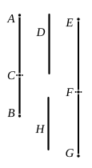

The corresponding *third apotome* [x. 87] is
$$m\sqrt{k}\cdot p - m\sqrt{k}\cdot p\sqrt{1 - \lambda^2}.$$
The two expressions are accordingly the roots of the equation
$$x^2 - 2m\sqrt{k}\cdot px + \lambda^2 m^2 kp^2 = 0,$$
or
$$x^2 - 2ax + \lambda^2 a^2 = 0,$$
where
$$a = m\sqrt{k}\cdot p.$$
See also note on **x. 53** (*ad fin.*).

---

### PROPOSITION 51.

To find the fourth binomial straight line.

Let two numbers $AC$, $CB$ be set out such that $AB$ 
neither has to $BC$, nor yet to $AC$, the ratio 
which a square number has to a square number.

Let a rational straight line $D$ be set out, 
and let $EF$ be commensurable in length with $D$;

therefore $EF$ is also rational.

Let it be contrived that, as the number $BA$ 
is to $AC$, so is the square on $EF$ to the square 
on $FG$; [x. 6, Por.]

therefore the square on $EF$ is commensurable 
with the square on $FG$; [x. 6] 
therefore $FG$ is also rational.

Now, since $BA$ has not to $AC$ the ratio which a square 
number has to a square number,

neither has the square on $EF$ to the square on $FG$ the ratio 
which a square number has to a square number; 
therefore $EF$ is incommensurable in length with $FG$. [x. 9]

Therefore $EF$, $FG$ are rational straight lines commen- 
surable in square only; 
so that $EG$ is binomial.

I say next that it is also a fourth binomial straight line.

For since, as $BA$ is to $AC$, so is the square on $EF$ to the 
square on $FG$,

therefore the square on $EF$ is greater than the square on $FG$.

Let then the squares on $FG$, $H$ be equal to the square 
on $EF$;
