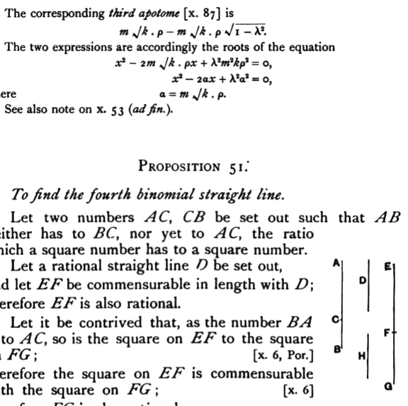

The corresponding *third apotome* [x. 87] is
$$m\sqrt{k}\cdot p - m\sqrt{k}\cdot p\sqrt{1 - \lambda^2}.$$
The two expressions are accordingly the roots of the equation
$$x^2 - 2m\sqrt{k}\cdot px + \lambda^2 m^2 kp^2 = 0,$$
or
$$x^2 - 2ax + \lambda^2 a^2 = 0,$$
where
$$a = m\sqrt{k}\cdot p.$$
See also note on **x. 53** (*ad fin.*).

---

### PROPOSITION 51.

#### *To find the fourth binomial straight line.*

Let two numbers *AC*, *CB* be set out such that *AB* neither has to *BC*, nor yet to *AC*, the ratio which a square number has to a square number.

Let a rational straight line *D* be set out, and let *EF* be commensurable in length with *D*; therefore *EF* is also rational.

Let it be contrived that, as the number *BA* is to *AC*, so is the square on *EF* to the square on *FG*; [x. 6, Por.] therefore the square on *EF* is commensurable with the square on *FG*; [x. 6] therefore *FG* is also rational.

Now, since *BA* has not to *AC* the ratio which a square number has to a square number, neither has the square on *EF* to the square on *FG* the ratio which a square number has to a square number; therefore *EF* is incommensurable in length with *FG*. [x. 9]

Therefore *EF*, *FG* are rational straight lines commensurable in square only; so that *EG* is binomial.

I say next that it is also a fourth binomial straight line.

For since, as *BA* is to *AC*, so is the square on *EF* to the square on *FG*, therefore the square on *EF* is greater than the square on *FG*.

Let then the squares on *FG*, *H* be equal to the square on *EF*;
