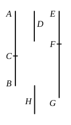

and let $EF$ be commensurable with $D$; therefore $EF$ is rational.

Let it be contrived that, as $CA$ is to $AB$, so is the square on $EF$ to the square on $FG$. [x. 6, Por.]

But $CA$ has not to $AB$ the ratio which a square number has to a square number; therefore neither has the square on $EF$ to the square on $FG$ the ratio which a square number has to a square number.

Therefore $EF$, $FG$ are rational straight lines commensurable in square only; [x. 9] therefore $EG$ is binomial. [x. 36]

I say next that it is also a fifth binomial straight line.

For since, as $CA$ is to $AB$, so is the square on $EF$ to the square on $FG$, inversely, as $BA$ is to $AC$, so is the square on $FG$ to the square on $FE$; therefore the square on $GF$ is greater than the square on $FE$.

Let then the squares on $EF$, $H$ be equal to the square on $GF$; therefore, *convertendo*, as the number $AB$ is to $BC$, so is the square on $GF$ to the square on $H$. [v. 19, Por.]

But $AB$ has not to $BC$ the ratio which a square number has to a square number; therefore neither has the square on $FG$ to the square on $H$ the ratio which a square number has to a square number.

Therefore $FG$ is incommensurable in length with $H$; [x. 9] so that the square on $FG$ is greater than the square on $FE$ by the square on a straight line incommensurable with $FG$.

And $GF$, $FE$ are rational straight lines commensurable in square only, and the lesser term $EF$ is commensurable in length with the rational straight line $D$ set out.

Therefore $EG$ is a fifth binomial straight line.

Q. E. D.

---

If $m$, $n$ be numbers of the kind taken in the last proposition, take $x$ such that
$$m : (m + n) = k^2 p^2 : x^2.$$
