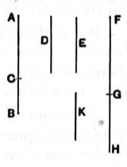

In this case
$$x = kp \sqrt{\frac{m + n}{m}} = kp \sqrt{1 + \lambda}\text{, say,}$$
and $x > kp$.

Then $kp \sqrt{1 + \lambda} + kp$ is a fifth binomial straight line.

For $\sqrt{x^2 - k^2 p^2}$, or $\sqrt{\lambda}\cdot kp$, is incommensurable in length with $kp \sqrt{1 + \lambda}$, or $x$; and $kp$, but not $kp \sqrt{1 + \lambda}$, is commensurable in length with $p$.

The corresponding *fifth apotome* [x. 89] is
$$kp \sqrt{1 + \lambda} - kp.$$

The equation of which the fifth binomial and the fifth apotome are the roots is
$$x^2 - 2kp \sqrt{1 + \lambda}\cdot x + \lambda k^2 p^2 = 0,$$
or
$$x^2 - 2ax + \frac{\lambda}{1 + \lambda} a^2 = 0,$$
where
$$a = kp \sqrt{1 + \lambda}.$$

---

### PROPOSITION 53.

#### *To find the sixth binomial straight line.*

Let two numbers *AC*, *CB* be set out such that *AB* has not to either of them the ratio which a square number has to a square number; and let there also be another number *D* which is not square and which has not to either of the numbers *BA*, *AC* the ratio which a square number has to a square number.

Let any rational straight line *E* be set out, and let it be contrived that, as *D* is to *AB*, so is the square on *E* to the square on *FG*; [x. 6, Por.] therefore the square on *E* is commensurable with the square on *FG*. [x. 6]

And *E* is rational; therefore *FG* is also rational.

Now, since *D* has not to *AB* the ratio which a square number has to a square number,
