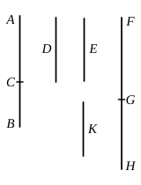

In this case
$$x = kp \sqrt{\frac{m + n}{m}} = kp \sqrt{1 + \lambda}\text{, say,}$$
and $x > kp$.

Then $kp \sqrt{1 + \lambda} + kp$ is a *fifth binomial* straight line.

For $\sqrt{x^2 - k^2 p^2}$, or $\sqrt{\lambda}\cdot kp$, is incommensurable in length with $kp \sqrt{1 + \lambda}$, or $x$; and $kp$, but not $kp \sqrt{1 + \lambda}$, is commensurable in length with $p$.

The corresponding *fifth apotome* [x. 89] is
$$kp \sqrt{1 + \lambda} - kp.$$

The equation of which the fifth binomial and the fifth apotome are the roots is
$$x^2 - 2kp \sqrt{1 + \lambda}\cdot x + \lambda k^2 p^2 = 0,$$
or
$$x^2 - 2ax + \frac{\lambda}{1 + \lambda} a^2 = 0,$$
where
$$a = kp \sqrt{1 + \lambda}.$$

---

### PROPOSITION 53.

To find the sixth binomial straight line.

Let two numbers $AC$, $CB$ be set out such that $AB$ has 
not to either of them the ratio which a 
square number has to a square number; 
and let there also be another number $D$ 
which is not square and which has not to 
either of the numbers $BA$, $AC$ the ratio 
which a square number has to a square 
number.

Let any rational straight line $E$ be set 
out, 
and let it be contrived that, as $D$ is to $AB$, 
so is the square on $E$ to the square on $FG$; [x. 6, Por.]

therefore the square on $E$ is commensurable with the square 
on $FG$. [x. 6]

And $E$ is rational;

therefore $FG$ is also rational.

Now, since $D$ has not to $AB$ the ratio which a square 
number has to a square number,

