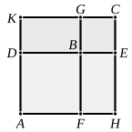

and the equation of which the two expressions are the roots is
$$x^2 - 2\sqrt{k}\cdot px + (k - \lambda)p^2 = 0,$$
or
$$x^2 - 2ax + \frac{k - \lambda}{k} a^2 = 0,$$
where $a = \sqrt{k}\cdot p$.

Tannery remarks ("De la solution g&eacute;om&eacute;trique des probl&egrave;mes du second degr&eacute; avant Euclide" in *M&eacute;moires de la Soci&eacute;t&eacute; des sciences physiques et naturelles de Bordeaux*, 2^e S&eacute;rie, T. iv.) that Euclid admits as binomials and apotomes the third and sixth binomials and apotomes which are the square roots of first binomials and apotomes respectively. Hence the third and sixth binomials and apotomes are the positive roots of biquadratic equations of the same form as the quadratics which give as roots the first and fourth binomials and apotomes. But this remark seems to be of no value because (as was pointed out a hundred years ago by Cossali, II. p. 260) the squares of *all* the six binomials and apotomes (including the first and fourth) give *first* binomials and apotomes respectively. Hence we may equally well regard them all as roots of biquadratics reducible to quadratics, or generally as roots of equations of the form
$$x^{2n} \pm 2a\cdot x^n \pm q = 0;$$
and nothing is gained by raising the degree of the equations in this way.

It is, of course, easy to see that the most general form of binomial and apotome, viz.
$$p\cdot\sqrt{k} \pm p\cdot\sqrt{\lambda},$$
give *first* binomials and apotomes when squared.

For the square is $p\{(k + \lambda)p \pm 2\sqrt{k\lambda}\cdot p\}$; and the expression within the bracket is a first binomial or apotome, because

(1) $k + \lambda > 2\sqrt{k\lambda}$,

(2) $\sqrt{(k + \lambda)^2 - 4k\lambda} = k - \lambda$, which is $\frown (k + \lambda)$,

(3) $(k + \lambda)p \frown p$.

---

### LEMMA.

Let there be two squares ">$AB$, ">$BC$, and let them be placed so that $DB$ is in a straight line with $BE$; therefore $FB$ is also in a straight line with $BG$.

Let the parallelogram ">$AC$ be completed; I say that ">$AC$ is a square, that ">$DG$ is a mean proportional between ">$AB$, ">$BC$, and further that ">$DC$ is a mean proportional between ">$AC$, ">$CB$.

For, since $DB$ is equal to $BF$, and $BE$ to $BG$, therefore the whole $DE$ is equal to the whole $FG$.

But $DE$ is equal to each of the straight lines $AH$, $KC$, and $FG$ is equal to each of the straight lines $AK$, $HC$; [I. 34]
