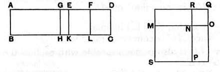

It is then manifest that *AE*, *ED* are rational straight lines commensurable in square only,
the square on *AE* is greater than the square on *ED* by the square on a straight line commensurable with *AE*,
and *AE* is commensurable in length with the rational straight line *AB* set out. [x. Deff. II. 1]
Let *ED* be bisected at the point *F*.

Then, since the square on *AE* is greater than the square on *ED* by the square on a straight line commensurable with *AE*,
therefore, if there be applied to the greater *AE* a parallelogram equal to the fourth part of the square on the less, that is, to the square on *EF*, and deficient by a square figure, it divides it into commensurable parts. [x. 17]
Let then the rectangle *AG*, *GE* equal to the square on *EF* be applied to *AE*;
therefore *AG* is commensurable in length with *EG*.
Let *GH*, *EK*, *FL* be drawn from *G*, *E*, *F* parallel to either of the straight lines *AB*, *CD*;
let the square *SN* be constructed equal to the parallelogram *AH*, and the square *NQ* equal to *GK*, [II. 14]
and let them be placed so that *MN* is in a straight line with *NO*;
therefore *RN* is also in a straight line with *NP*.
And let the parallelogram *SQ* be completed;
therefore *SQ* is a square. [Lemma]
Now, since the rectangle *AG*, *GE* is equal to the square on *EF*,
therefore, as *AG* is to *EF*, so is *FE* to *EG*; [VI. 17]
therefore also, as *AH* is to *EL*, so is *EL* to *KG*; [VI. 1]
therefore *EL* is a mean proportional between *AH*, *GK*.
But *AH* is equal to *SN*, and *GK* to *NQ*;
therefore *EL* is a mean proportional between *SN*, *NQ*.
