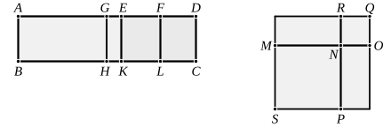

It is then manifest that $AE$, $ED$ are rational straight lines 
commensurable in square only, 
the square on $AE$ is greater than the square on $ED$ by the 
square on a straight line commensurable with $AE$, 
and $AE$ is commensurable in length with the rational straight 
line $AB$ set out. [X. Deff. II. 1]

Let $ED$ be bisected at the point $F$.

Then, since the square on $AE$ is greater than the square 
on $ED$ by the square on a straight line commensurable with 
$AE$,

therefore, if there be applied to the greater $AE$ a parallelogram 
equal to the fourth part of the square on the less, that is, to 
the square on $EF$, and deficient by a square figure, it divides 
it into commensurable parts. [X. 17]

Let then the rectangle $AG$, $GE$ equal to the square on 
$EF$ be applied to $AE$;

therefore $AG$ is commensurable in length with $EG$.

Let $GH$, $EK$, $FL$ be drawn from $G$, $E$, $F$ parallel to 
either of the straight lines $AB$, $CD$; 
let the square ">$SN$ be constructed equal to the parallelogram 
">$AH$, and the square ">$NQ$ equal to ">$GK$, [II. 14] 
and let them be placed so that $MN$ is in a straight line with 
$NO$;

therefore $RN$ is also in a straight line with $NP$.

And let the parallelogram ">$SQ$ be completed;

therefore ">$SQ$ is a square. [Lemma]

Now, since the rectangle $AG$, $GE$ is equal to the square 
on $EF$,

therefore, as $AG$ is to $EF$, so is $FE$ to $EG$; [VI. 17]

therefore also, as ">$AH$ is to ">$EL$, so is ">$EL$ to ">$KG$; [VI. 1]

therefore ">$EL$ is a mean proportional between ">$AH$, ">$GK$.

But ">$AH$ is equal to ">$SN$, and ">$GK$ to ">$NQ$;

therefore ">$EL$ is a mean proportional between ">$SN$, ">$NQ$.

