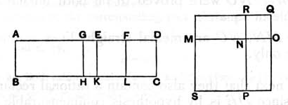

and let there be applied to *AE* the rectangle *AG*, *GE* equal to the square on *EF* and deficient by a square figure;
therefore *AG* is commensurable in length with *GE*. [x. 17]
Through *G*, *E*, *F* let *GH*, *EK*, *FL* be drawn parallel to
20 *AB*, *CD*,
let the square *SN* be constructed equal to the parallelogram *AH*, and the square *NQ* equal to *GK*,
and let them be placed so that *MN* is in a straight line with *NO*;
25 therefore *RN* is also in a straight line with *NP*.

Let the square *SQ* be completed.
It is then manifest from what was proved before that *MR* is a mean proportional between *SN*, *NQ* and is equal to *EL*, and that *MO* is the "side" of the area *AC*.
30 It is now to be proved that *MO* is a first bimedial straight line.
Since *AE* is incommensurable in length with *ED*,
while *ED* is commensurable with *AB*,
therefore *AE* is incommensurable with *AB*. [x. 13]
And, since *AG* is commensurable with *EG*,
35 *AE* is also commensurable with each of the straight lines *AG*, *GE*. [x. 15]
But *AE* is incommensurable in length with *AB*;
therefore *AG*, *GE* are also incommensurable with *AB*. [x. 13]
Therefore *BA*, *AG* and *BA*, *GE* are pairs of rational
40 straight lines commensurable in square only;
so that each of the rectangles *AH*, *GK* is medial. [x. 21]
Hence each of the squares *SN*, *NQ* is medial.
Therefore *MN*, *NO* are also medial.
And, since *AG* is commensurable in length with *GE*,
45 *AH* is also commensurable with *GK*, [VI. 1, x. 11]
that is, *SN* is commensurable with *NQ*,
that is, the square on *MN* with the square on *NO*.
