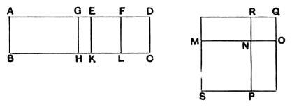

128 BOOK X [x. 58

### PROPOSITION 58.

*If an area be contained by a rational straight line and the fifth binomial, the "side" of the area is the irrational straight line called the side of a rational plus a medial area.*

For let the area $AC$ be contained by the rational straight line $AB$ and the fifth binomial $AD$ divided into its terms at $E$, so that $AE$ is the greater term;
I say that the "side" of the area $AC$ is the irrational straight line called the side of a rational plus a medial area.

For let the same construction be made as before shown;
it is then manifest that $MO$ is the "side" of the area $AC$.

It is then to be proved that $MO$ is the side of a rational plus a medial area.

For, since $AG$ is incommensurable with $GE$, [x. 18]
therefore $AH$ is also commensurable with $HE$, [VI. 1, x. 11]
that is, the square on $MN$ with the square on $NO$;
therefore $MN$, $NO$ are incommensurable in square.

And, since $AD$ is a fifth binomial straight line, and $ED$ the lesser segment,
therefore $ED$ is commensurable in length with $AB$. [x. Deff. II. 5]

But $AE$ is incommensurable with $ED$;
therefore $AB$ is also incommensurable in length with $AE$. [x. 13]

Therefore $AK$, that is, the sum of the squares on $MN$, $NO$, is medial. [x. 21]

And, since $DE$ is commensurable in length with $AB$, that is, with $EK$,
while $DE$ is commensurable with $EF$,
therefore $EF$ is also commensurable with $EK$. [x. 12]
