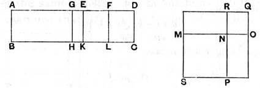

130 BOOK X [x. 59

### PROPOSITION 59.

*If an area be contained by a rational straight line and the sixth binomial, the "side" of the area is the irrational straight line called the side of the sum of two medial areas.*

For let the area $ABCD$ be contained by the rational straight line $AB$ and the sixth binomial $AD$, divided into its terms at $E$, so that $AE$ is the greater term;
I say that the "side" of $AC$ is the side of the sum of two medial areas.

Let the same construction be made as before shown.

It is then manifest that $MO$ is the "side" of $AC$, and that $MN$ is incommensurable in square with $NO$.

Now, since $EA$ is incommensurable in length with $AB$,
therefore $EA$, $AB$ are rational straight lines commensurable in square only;
therefore $AK$, that is, the sum of the squares on $MN$, $NO$, is medial. [x. 21]

Again, since $ED$ is incommensurable in length with $AB$,
therefore $FE$ is also incommensurable with $EK$; [x. 13]
therefore $FE$, $EK$ are rational straight lines commensurable in square only;
therefore $EL$, that is, $MR$, that is, the rectangle $MN$, $NO$, is medial. [x. 21]

And, since $AE$ is incommensurable with $EF$,
$AK$ is also incommensurable with $EL$. [VI. 1, x. 11]

But $AK$ is the sum of the squares on $MN$, $NO$, and $EL$ is the rectangle $MN$, $NO$;
therefore the sum of the squares on $MN$, $NO$ is incommensurable with the rectangle $MN$, $NO$.

And each of them is medial, and $MN$, $NO$ are incommensurable in square.
