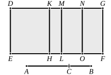

For let $AB$ be bisected at $D$.

Since then a straight line has been cut into equal parts 
at $D$, and into unequal parts at $C$,

therefore the rectangle $AC$, $CB$ together with the square on 
$CD$ is equal to the square on $AD$, [II. 5] 
so that the rectangle $AC$, $CB$ is less than the square on $AD$ ; 
therefore twice the rectangle $AC$, $CB$ is less than double of 
the square on $AD$.

But the squares on $AC$, $CB$ are double of the squares on 
$AD$, $DC$ ; [II. 9]

therefore the squares on $AC$, $CB$ are greater than twice the 
rectangle $AC$, $CB$.Q. E. D.]

We have already remarked (note on X. 44) that the Lemma here proving 
that
$$x^2 + y^2 > 2xy$$
can hardly be genuine, since the result is used in X. 44.

---

### PROPOSITION 60.

The square on the binomial straight line applied to a 
rational straight line produces as breadth the first binomial.

Let $AB$ be a binomial straight line divided into its terms 
at $C$, so that $AC$ is the greater term ; 
let a rational straight line $DE$ be 
set out, 
and let ">$DEFG$ equal to the square 
on $AB$ be applied to $DE$ producing 
$DG$ as its breadth ; 
I say that $DG$ is a first binomial 
straight line.

For let there be applied to $DE$ the rectangle ">$DH$ equal 
to the square on $AC$, and ">$KL$ equal to the square on $BC$ ; 

therefore the remainder, twice the rectangle $AC$, $CB$, is equal 
to ">$MF$.

Let $MG$ be bisected at $N$, and let $NO$ be drawn parallel 
[to $ML$ or $GF$].

Therefore each of the rectangles ">$MO$, ">$NF$ is equal to 
once the rectangle $AC$, $CB$.

Now, since $AB$ is a binomial divided into its terms at $C$,

