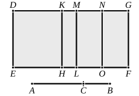

($\alpha$) $\rho \sim \sqrt{k} \cdot \rho$, so that $\rho^2, k\rho^2$ are rational and commensurable; 
therefore $\rho^2 + k\rho^2$, or $\sigma (x + y)$, is a rational area,
whence
$$(x + y)\text{ is rational and } \sim \sigma \dots\dots\dots\dots\dots\dots\dots\dots\dots\dots(1).$$
Next, $2\rho \cdot \sqrt{k} \cdot \rho$ is a medial area, 
so that $\sigma \cdot 2z$ is a medial area,
whence
$$2z\text{ is rational but } \smile \sigma \dots\dots\dots\dots\dots\dots\dots\dots\dots\dots(2).$$
Hence [(1), (2)] $(x + y), 2z$ are rational and commensurable in square 
only $\dots\dots\dots\dots\dots\dots\dots\dots\dots\dots\dots\dots\dots\dots\dots\dots\dots\dots\dots\dots\dots\dots\dots\dots\dots\dots\dots\dots(3);$ 
thus $(x + y) + 2z$ is a *binomial* straight line. [X. 36]

($\beta$)
$$\rho^2 : \sqrt{k} \cdot \rho^2 = \sqrt{k} \cdot \rho^2 : k\rho^2,$$
so that
$$\sigma x : \sigma z = \sigma z : \sigma y,$$
and
$$x : z = z : y,$$
or
$$xy = z^2 = \frac{1}{4}(2z)^2 \dots\dots\dots\dots\dots\dots\dots\dots\dots\dots\dots\dots\dots\dots(4).$$
Now $\rho^2, k\rho^2$ are commensurable, so that $\sigma x, \sigma y$ are commensurable, and 
therefore
$$x \sim y \dots\dots\dots\dots\dots\dots\dots\dots\dots\dots\dots\dots\dots\dots\dots\dots\dots\dots\dots(5).$$
And, since [Lemma] $\rho^2 + k\rho^2 > 2\sqrt{k} \cdot \rho^2,$
$$x + y > 2z.$$
But $(x + y)$ is given, being equal to $\frac{\rho^2 + k\rho^2}{\sigma} \dots\dots\dots\dots\dots\dots\dots\dots(6).$

Therefore [(4), (5), (6), and X. 17] $\sqrt{(x + y)^2 - (2z)^2} \sim (x + y).$ 
And $(x + y), 2z$ are rational and $\smile$ [(3)], 
while $(x + y) \sim \sigma$ [(1)].

Hence $(x + y) + 2z$ is a *first binomial*.

The actual value of $(x + y) + 2z$ is, of course,
$$\frac{\rho^2}{\sigma}(1 + k + 2\sqrt{k}).$$

---

### PROPOSITION 61.

The square on the first bimedial straight line applied to a 
rational straight line produces as breadth the second binomial.

Let $AB$ be a first bimedial straight line divided into its 
medials at $C$, of which medials $AC$ 
is the greater; 
let a rational straight line $DE$ be set 
out, 
and let there be applied to $DE$ the 
parallelogram ">$DF$ equal to the square 
on $AB$, producing $DG$ as its breadth; 
I say that $DG$ is a second binomial 
straight line.

For let the same construction as before be made.
