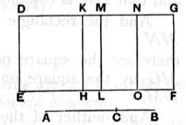

The form of the proposition and the figure being similar to those of x. 60, I can somewhat abbreviate the reproduction of the proof.
Take $x, y, z$ such that
$$\begin{aligned}
\sigma x &= k^{\frac{1}{2}}\rho^2,\\
\sigma y &= k^{\frac{3}{2}}\rho^2,\\
\sigma \cdot 2z &= 2k\rho^2.
\end{aligned}$$
Then shall $(x + y) + 2z$ be a second binomial.

($\alpha$) $k^{\frac{1}{4}}\rho, k^{\frac{3}{4}}\rho$ are medial straight lines commensurable in square only and containing a rational rectangle. [x. 37]
The squares $k^{\frac{1}{2}}\rho^2, k^{\frac{3}{2}}\rho^2$ are medial; thus the sum, or $\sigma (x + y)$, is medial. [x. 23, Por.]
Therefore $(x + y)$ is rational and $\smile \sigma.$
And $\sigma \cdot 2z$ is rational; therefore
$$2z\text{ is rational and } \sim \sigma \dots\dots\dots\dots\dots\dots\dots\dots\dots\dots(1).$$
Therefore $(x + y), 2z$ are rational and $\smile \dots\dots\dots\dots\dots\dots\dots\dots\dots\dots(2),$
so that
$$(x + y) + 2z\text{ is a *binomial*}.$$

($\beta$) As before,
$$(x + y) > 2z.$$
Now, $k^{\frac{1}{2}}\rho^2, k^{\frac{3}{2}}\rho^2$ being commensurable,
$$x \sim y.$$
And
$$xy = z^2,$$
while
$$x + y = \frac{k^{\frac{1}{2}}\rho^2 + k^{\frac{3}{2}}\rho^2}{\sigma}.$$
Hence [x. 17]
$$\sqrt{(x + y)^2 - (2z)^2} \sim (x + y) \dots\dots\dots\dots\dots\dots\dots\dots(3).$$
But $2z \sim \sigma,$ by (1).
Therefore [(1), (2), (3)] $(x + y) + 2z$ is a *second binomial* straight line.
Of course
$$(x + y) + 2z = \frac{\rho^2}{\sigma}\{\sqrt{k}(1 + k) + 2k\}.$$

---

### PROPOSITION 62.

*The square on the second bimedial straight line applied to a rational straight line produces as breadth the third binomial.*

Let $AB$ be a second bimedial straight line divided into its medials at $C$, so that $AC$ is the greater segment; let $DE$ be any rational straight line, and to $DE$ let there be applied the parallelogram $DF$ equal to the square on $AB$ and producing $DG$ as its breadth;
I say that $DG$ is a third binomial straight line.

Let the same construction be made as before shown.
