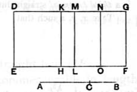

and to *DE* let there be applied the parallelogram *DF* equal to the square on *AB* and producing *DG* as its breadth ;
I say that *DG* is a fourth binomial straight line.

   Let the same construction be made as before shown.
   Then, since *AB* is a major straight line divided at *C*,
*AC*, *CB* are straight lines incommensurable in square which make the sum of the squares on them rational, but the rectangle contained by them medial. [x. 39]
   Since then the sum of the squares on *AC*, *CB* is rational,
therefore *DL* is rational ;
therefore *DM* is also rational and commensurable in length with *DE*. [x. 20]
   Again, since twice the rectangle *AC*, *CB*, that is, *MF*, is medial,
and it is applied to the rational straight line *ML*,
therefore *MG* is also rational and incommensurable in length with *DE* ; [x. 22]
therefore *DM* is also incommensurable in length with *MG*. [x. 13]
   Therefore *DM*, *MG* are rational straight lines commensurable in square only ;
therefore *DG* is binomial. [x. 36]
   It is to be proved that it is also a fourth binomial straight line.
   In manner similar to the foregoing we can prove that *DM* is greater than *MG*,
and that the rectangle *DK*, *KM* is equal to the square on *MN*.
   Since then the square on *AC* is incommensurable with the square on *CB*,
therefore *DH* is also incommensurable with *KL*,
so that *DK* is also incommensurable with *KM*. [vI. 1, x. 11]
   But, if there be two unequal straight lines, and to the greater there be applied a parallelogram equal to the fourth part of the square on the less and deficient by a square figure, and if it divide it into incommensurable parts, then the
