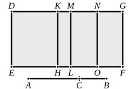

I say that $DG$ is a sixth binomial straight line.

For let the same construction be made as before.

Then, since $AB$ is the side of 
the sum of two medial areas, divided 
at $C$,

therefore $AC$, $CB$ are straight lines 
incommensurable in square which 
make the sum of the squares on 
them medial, the rectangle contained 
by them medial, and moreover the 
sum of the squares on them incom- 
mensurable with the rectangle contained by them, [X. 41] 
so that, in accordance with what was before proved, each of 
the rectangles ">$DL$, ">$MF$ is medial.

And they are applied to the rational straight line $DE$;

therefore each of the straight lines $DM$, $MG$ is rational and 
incommensurable in length with $DE$. [X. 22]

And, since the sum of the squares on $AC$, $CB$ is incom- 
mensurable with twice the rectangle $AC$, $CB$,

therefore ">$DL$ is incommensurable with ">$MF$.

Therefore $DM$ is also incommensurable with $MG$; 
[VI. 1, X. 11] 
therefore $DM$, $MG$ are rational straight lines commensurable 
in square only; 
therefore $DG$ is binomial. [X. 36]

I say next that it is also a sixth binomial straight line.

Similarly again we can prove that the rectangle $DK$, $KM$ 
is equal to the square on $MN$, 
and that $DK$ is incommensurable in length with $KM$; 
and, for the same reason, the square on $DM$ is greater than 
the square on $MG$ by the square on a straight line incom- 
mensurable in length with $DM$.

And neither of the straight lines $DM$, $MG$ is commen- 
surable in length with the rational straight line $DE$ set out.

Therefore $DG$ is a sixth binomial straight line.Q. E. D.

