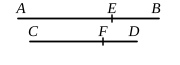

But, if neither of the straight lines *AE*, *EB* is commensurable with the rational straight line set out, neither of the straight lines *CF*, *FD* will be commensurable with it, [x. 13]
and each of the straight lines *AB*, *CD* is a third binomial. [x. Deff. II. 3]

But, if the square on *AE* is greater than the square on *EB* by the square on a straight line incommensurable with *AE*,
the square on *CF* is also greater than the square on *FD* by the square on a straight line incommensurable with *CF*. [x. 14]

And, if *AE* is commensurable with the rational straight line set out, *CF* is also commensurable with it,
and each of the straight lines *AB*, *CD* is a fourth binomial. [x. Deff. II. 4]

But, if *EB* is so commensurable, so is *FD* also,
and each of the straight lines *AB*, *CD* will be a fifth binomial. [x. Deff. II. 5]

But, if neither of the straight lines *AE*, *EB* is so commensurable, neither of the straight lines *CF*, *FD* is commensurable with the rational straight line set out,
and each of the straight lines *AB*, *CD* will be a sixth binomial. [x. Deff. II. 6]

Hence a straight line commensurable in length with a binomial straight line is binomial and the same in order.

Q. E. D.

---

The proofs of this and the following propositions up to X. 70 inclusive are easy and require no elucidation. They are equivalent to saying that, if in each of the preceding irrational straight lines $\frac{m}{n}\rho$ is substituted for $\rho$, the resulting irrational is of the same kind as that from which it is altered.

---

### PROPOSITION 67.

*A straight line commensurable in length with a bimedial straight line is itself also bimedial and the same in order.*

Let *AB* be bimedial, and let *CD* be commensurable in length with *AB*;
I say that *CD* is bimedial and the same in order with *AB*.

For, since *AB* is bimedial, let it be divided into its medials at *E*;
