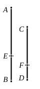

And the squares on $AE$, $EB$ together are rational;

therefore the squares on $CF$, $FD$ together are rational.

Similarly also twice the rectangle $AE$, $EB$ is commen- 
surable with twice the rectangle $CF$, $FD$.

And twice the rectangle $AE$, $EB$ is medial;

therefore twice the rectangle $CF$, $FD$ is also medial. [x. 23, Por.]

Therefore $CF$, $FD$ are straight lines incommensurable in 
square which make, at the same time, the sum of the squares 
on them rational, but the rectangle contained by them medial; 
therefore the whole $CD$ is the irrational straight line called 
major. [x. 39]

Therefore a straight line commensurable with the major 
straight line is major.Q. E. D.

---

### PROPOSITION 69.

A straight line commensurable with the side of a rational 
plus a medial area is itself also the side of a rational plus a 
medial area.

Let $AB$ be the side of a rational plus a medial area, 
and let $CD$ be commensurable with $AB$; 
it is to be proved that $CD$ is also the side of a 
rational plus a medial area.

Let $AB$ be divided into its straight lines at $E$;

therefore $AE$, $EB$ are straight lines incommensur- 
able in square which make the sum of the squares 
on them medial, but the rectangle contained by them 
rational. [x. 40]

Let the same construction be made as before.

We can then prove similarly that 
$CF$, $FD$ are incommensurable in square, 
and the sum of the squares on $AE$, $EB$ is commensurable 
with the sum of the squares on $CF$, $FD$, 
and the rectangle $AE$, $EB$ with the rectangle $CF$, $FD$; 
so that the sum of the squares on $CF$, $FD$ is also medial, and 
the rectangle $CF$, $FD$ rational.

Therefore $CD$ is the side of a rational plus a medial area.Q. E. D.

