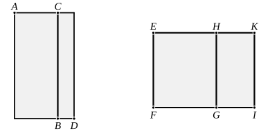

For ">$AB$ is either greater or less than ">$CD$.

First, let it be greater; 
let a rational straight line $EF$ be set out, 
let there be applied to $EF$ the rectangle ">$EG$ equal to ">$AB$, 
producing $EH$ as breadth, 
and let ">$HI$, equal to ">$DC$, be applied to $EF$, producing $HK$ 
as breadth.

Then, since ">$AB$ is rational and is equal to ">$EG$,

therefore ">$EG$ is also rational.

And it has been applied to $EF$, producing $EH$ as breadth;

therefore $EH$ is rational and commensurable in length with 
$EF$. [x. 20]

Again, since ">$CD$ is medial and is equal to ">$HI$,

therefore ">$HI$ is also medial.

And it is applied to the rational straight line $EF$, pro- 
ducing $HK$ as breadth;

therefore $HK$ is rational and incommensurable in length 
with $EF$. [x. 22]

And, since ">$CD$ is medial, 
while ">$AB$ is rational,

therefore ">$AB$ is incommensurable with ">$CD$, 
so that ">$EG$ is also incommensurable with ">$HI$.

But, as ">$EG$ is to ">$HI$, so is $EH$ to $HK$; [vi. 1]

therefore $EH$ is also incommensurable in length with $HK$. 
[x. 11]

And both are rational;

therefore $EH$, $HK$ are rational straight lines commensurable 
in square only; 
therefore $EK$ is a binomial straight line, divided at $H$. [x. 36]

