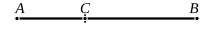

For from the medial straight line *AB* let there be subtracted the medial straight line *BC* which is commensurable with *AB* in square only and with *AB* makes the rectangle *AB*, *BC* rational;

I say that the remainder *AC* is irrational; and let it be called a **first apotome of a medial straight line**.

For, since *AB*, *BC* are medial,
the squares on *AB*, *BC* are also medial.

But twice the rectangle *AB*, *BC* is rational;
therefore the squares on *AB*, *BC* are incommensurable with twice the rectangle *AB*, *BC*;
therefore twice the rectangle *AB*, *BC* is also incommensurable with the remainder, the square on *AC*, [cf. II. 7]
since, if the whole is incommensurable with one of the magnitudes, the original magnitudes will also be incommensurable. [X. 16]

But twice the rectangle *AB*, *BC* is rational;
therefore the square on *AC* is irrational;
therefore *AC* is irrational. [X. Def. 4]

And let it be called a **first apotome of a medial straight line.**

---

The *first apotome of a medial straight line* is the difference between straight lines of the form $k^{\frac{1}{4}}\rho, k^{\frac{3}{4}}\rho$, which are medial straight lines commensurable in square only and forming a rational rectangle.

By hypothesis, $x^2, y^2$ are medial areas.

And, since $xy$ is rational,
$$(x^2 + y^2) \smile xy$$
$$\smile 2xy,$$
whence
$$(x - y)^2 \smile 2xy.$$

But $2xy$ is rational;
therefore $(x - y)^2$, and consequently $(x - y)$, is irrational.

This irrational, which is of the form $(k^{\frac{1}{4}}\rho \sim k^{\frac{3}{4}}\rho)$, is the *first apotome of a medial straight line*; the term corresponding of course to *first bimedial*, which applies where the sign is positive.
