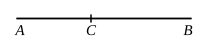

Then $\sigma u, \sigma v$ are medial areas,  
so that $u, v$ are both rational and $\smile \sigma$ .........................................(1).

Again,
$$x \smile y;$$
therefore
$$x^2 \smile xy,$$
and consequently
$$x^2 + y^2 \smile 2xy,$$
or
$$\sigma u \smile \sigma v,$$
and
$$u \smile v$$ .................................................(2).

Thus [(1), (2)] $u, v$ are rational and $\sim$;  
therefore [x. 73] $(u - v)$ is an *apotome*,  
and, $(u - v)$ being thus irrational,
$$(u - v)\sigma \text{ is an irrational area.}$$

Hence $(x - y)^2$, and consequently $(x - y)$, is irrational.

The irrational straight line $k^{\frac{1}{4}}\rho \sim \frac{\sqrt\lambda \cdot \rho}{k^{\frac{1}{4}}}$ is called a **second apotome of a medial straight line.**

---

### PROPOSITION 76.

*If from a straight line there be subtracted a straight line which is incommensurable in square with the whole and which with the whole makes the squares on them added together rational, but the rectangle contained by them medial, the remainder is irrational; and let it be called* **minor.**

For from the straight line $AB$ let there be subtracted the straight line $BC$ which is incommensurable in square with the whole and fulfils the given conditions. [x. 33]

I say that the remainder $AC$ is the irrational straight line called **minor.**

For, since the sum of the squares on $AB$, $BC$ is rational,  
while twice the rectangle $AB$, $BC$ is medial,  
therefore the squares on $AB$, $BC$ are incommensurable with twice the rectangle $AB$, $BC$;  
and, *convertendo*, the squares on $AB$, $BC$ are incommensurable with the remainder, the square on $AC$. [II. 7, x. 16]

But the squares on $AB$, $BC$ are rational;  
therefore the square on $AC$ is irrational;  
therefore $AC$ is irrational.

And let it be called **minor.**

Q. E. D.

