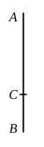

$x, y$ are here of the form found in x. 33, viz.
$$\frac{\rho}{\sqrt 2} \sqrt{1 + \frac{k}{\sqrt{1 + k^2}}}, \quad \frac{\rho}{\sqrt 2} \sqrt{1 - \frac{k}{\sqrt{1 + k^2}}}.$$

By hypothesis $(x^2 + y^2)$ is a rational, $xy$ a medial, area.  
Therefore
$$(x^2 + y^2) \smile 2xy,$$
whence
$$(x - y)^2 \smile (x^2 + y^2).$$

Therefore $(x - y)^2$, and consequently $(x - y)$, is irrational.  
The *minor* (irrational) straight line is thus of the form
$$\frac{\rho}{\sqrt 2} \sqrt{1 + \frac{k}{\sqrt{1 + k^2}}} - \frac{\rho}{\sqrt 2} \sqrt{1 - \frac{k}{\sqrt{1 + k^2}}}.$$

Observe the use of *convertendo* ($\alpha\nu\alpha\sigma\tau\rho\acute{\epsilon}\psi\alpha\nu\tau\iota$) for the inference that, since 
$(x^2 + y^2) \smile 2xy$, $(x^2 + y^2) \smile (x - y)^2$. The use of the word corresponds exactly 
to its use in proportions.

---

### PROPOSITION 77.

If from a straight line there be subtracted a straight line 
which is incommensurable in square with the whole, and which 
with the whole makes the sum of the squares on them medial, 
but twice the rectangle contained by them rational, the remainder 
is irrational: and let it be called <strong>that which produces with 
a rational area a medial whole.</strong>

For from the straight line $AB$ let there be subtracted the 
straight line $BC$ which is incommensurable in square 
with $AB$ and fulfils the given conditions ; [X. 34] 
I say that the remainder $AC$ is the irrational straight 
line aforesaid.

For, since the sum of the squares on $AB$, $BC$ is 
medial, 
while twice the rectangle $AB$, $BC$ is rational,

therefore the squares on $AB$, $BC$ are incommensurable 
with twice the rectangle $AB$, $BC$ ; 
therefore the remainder also, the square on $AC$, is incom- 
mensurable with twice the rectangle $AB$, $BC$. [II. 7, X. 16]

And twice the rectangle $AB$, $BC$ is rational ;

therefore the square on $AC$ is irrational ; 
therefore $AC$ is irrational.

And let it be called <strong>that which produces with a 
rational area a medial whole.</strong>Q. E. D.

