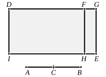

Here $x, y$ are of the form [cf. x. 34]
$$\frac{\rho}{\sqrt{2(1 + k^2)}} \sqrt{\sqrt{1 + k^2} + k}, \quad \frac{\rho}{\sqrt{2(1 + k^2)}} \sqrt{\sqrt{1 + k^2} - k}.$$

By hypothesis, $(x^2 + y^2)$ is a medial, $xy$ a rational, area;  
thus
$$(x^2 + y^2) \smile 2xy,$$
and therefore
$$(x - y)^2 \smile 2xy,$$
whence $(x - y)^2$, and consequently $(x - y)$, is irrational.

The irrational straight line
$$\frac{\rho}{\sqrt{2(1 + k^2)}} \sqrt{\sqrt{1 + k^2} + k} - \frac{\rho}{\sqrt{2(1 + k^2)}} \sqrt{\sqrt{1 + k^2} - k}$$
is called *that which produces with a rational area a medial whole* or more 
literally *that which with a rational area makes the whole medial* (ἡ μετὰ ῥητοῦ 
μέσον τὸ ὅλον ποιοῦσα). Here "produces" means "produces when a square 
is described on it." A clearer way of expressing the meaning would be to call 
this straight line the "*side*" of a medial minus a rational area corresponding 
to the "*side*" of a rational plus a medial area [x. 40].

---

### PROPOSITION 78.

If from a straight line there be subtracted a straight line 
which is incommensurable in square with the whole and which 
with the whole makes the sum of the squares on them medial, 
twice the rectangle contained by them medial, and further the 
squares on them incommensurable with twice the rectangle 
contained by them, the remainder is irrational; and let it be 
called <strong>that which produces with a medial area a 
medial whole.</strong>

For from the straight line $AB$ let there be subtracted the 
straight line $BC$ incommensurable in 
square with $AB$ and fulfilling the 
given conditions ; [X. 35]

I say that the remainder $AC$ is the 
irrational straight line called <strong>that 
which produces with a medial 
area a medial whole.</strong>

For let a rational straight line $DI$ 
be set out, 
to $DI$ let there be applied ">$DE$ equal to the squares on $AB$, 
$BC$, producing $DG$ as breadth, 
and let ">$DH$ equal to twice the rectangle $AB$, $BC$ be 
subtracted.
