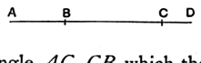

For let *AB* be a first apotome of a medial straight line,
and let *BC* be an annex to *AB*;
therefore *AC*, *CB* are medial
straight lines commensurable in
square only and such that the rectangle *AC*, *CB* which they
contain is rational; \[[x. 74](x.74.md)\]

I say that no other medial straight line can be annexed to
*AB* which is commensurable with the whole in square only
and which contains with the whole a rational area.

For, if possible, let *DB* be so annexed;
therefore *AD*, *DB* are medial straight lines commensurable
in square only and such that the rectangle *AD*, *DB* which
they contain is rational. \[[x. 74](x.74.md)\]

Now, since the excess of the squares on *AD*, *DB* over
twice the rectangle *AD*, *DB* is also the excess of the squares
on *AC*, *CB* over twice the rectangle *AC*, *CB*,
for they exceed by the same, the square on *AB*, \[[II. 7](II.7.md)\]
therefore, alternately, the excess of the squares on *AD*, *DB*
over the squares on *AC*, *CB* is also the excess of twice the
rectangle *AD*, *DB* over twice the rectangle *AC*, *CB*.

But twice the rectangle *AD*, *DB* exceeds twice the rect-
angle *AC*, *CB* by a rational area,
for both are rational.

Therefore the squares on *AD*, *DB* also exceed the squares
on *AC*, *CB* by a rational area:
which is impossible,
for both are medial \[[x. 15 and 23, Por.](x.15.md)\], and a medial area does
not exceed a medial by a rational area. \[[x. 26](x.26.md)\]

Therefore etc.

$$\text{Q. E. D.}$$

---

Suppose, if possible, that the same *first apotome of a medial* straight line
can be expressed in terms of the required character in two ways, so that
$$x - y = x' - y',$$
and suppose that $x > x'$.

In this case $x^2 + y^2$, $(x'^2 + y'^2)$ are both medial areas, and $2xy$, $2x'y'$ are both
rational areas;
and
$$x^2 + y^2 - (x'^2 + y'^2) = 2xy - 2x'y'.$$

Hence x. 26 is contradicted again;
therefore etc.
