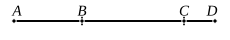

For let $AB$ be a first apotome of a medial straight line, 
and let $BC$ be an annex to $AB$;

therefore $AC$, $CB$ are medial 
straight lines commensurable in 
square only and such that the rectangle $AC$, $CB$ which they 
contain is rational; [X. 74]

I say that no other medial straight line can be annexed to 
$AB$ which is commensurable with the whole in square only 
and which contains with the whole a rational area.

For, if possible, let $DB$ also be so annexed;

therefore $AD$, $DB$ are medial straight lines commensurable 
in square only and such that the rectangle $AD$, $DB$ which 
they contain is rational. [X. 74]

Now, since the excess of the squares on $AD$, $DB$ over 
twice the rectangle $AD$, $DB$ is also the excess of the squares 
on $AC$, $CB$ over twice the rectangle $AC$, $CB$, 
for they exceed by the same, the square on $AB$, [II. 7]

therefore, alternately, the excess of the squares on $AD$, $DB$ 
over the squares on $AC$, $CB$ is also the excess of twice the 
rectangle $AD$, $DB$ over twice the rectangle $AC$, $CB$.

But twice the rectangle $AD$, $DB$ exceeds twice the rect- 
angle $AC$, $CB$ by a rational area, 
for both are rational.

Therefore the squares on $AD$, $DB$ also exceed the squares 
on $AC$, $CB$ by a rational area: 
which is impossible, 
for both are medial [X. 15 and 23, Por.], and a medial area does 
not exceed a medial by a rational area. [X. 26]

Therefore etc.Q. E. D.

---

Suppose, if possible, that the same *first apotome of a medial* straight line 
can be expressed in terms of the required character in two ways, so that
$$x - y = x' - y',$$
and suppose that $x > x'$.

In this case $x^2 + y^2$, $(x'^2 + y'^2)$ are both medial areas, and $2xy$, $2x'y'$ are both 
rational areas;
and
$$x^2 + y^2 - (x'^2 + y'^2) = 2xy - 2x'y'.$$

Hence x. 26 is contradicted again; 
therefore etc.
