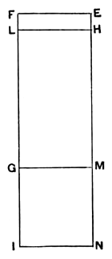

### Proposition 81.

*To a second apotome of a medial straight line only one
medial straight line can be annexed which is commensurable
with the whole in square only and which contains with the
whole a medial rectangle.*

Let *AB* be a second apotome of a medial straight line
and *BC* an annex to *AB*;
therefore *AC*, *CB* are medial straight
lines commensurable in square only and
such that the rectangle *AC*, *CB* which
they contain is medial. \[[x. 75](x.75.md)\]

I say that no other medial straight line
can be annexed to *AB* which is commen-
surable with the whole in square only and
which contains with the whole a medial
rectangle.

For, if possible, let *BD* also be so
annexed;
therefore *AD*, *DB* are also medial straight
lines commensurable in square only and
such that the rectangle *AD*, *DB* which
they contain is medial. \[[x. 75](x.75.md)\]

Let a rational straight line *EF* be set out,
let *EG* equal to the squares on *AC*, *CB* be applied to *EF*,
producing *EM* as breadth,
and let *HG* equal to twice the rectangle *AC*, *CB* be sub-
tracted, producing *HM* as breadth;
therefore the remainder *EL* is equal to the square on *AB*,
\[[II. 7](II.7.md)\]
so that *AB* is the "side" of *EL*.

Again, let *EI* equal to the squares on *AD*, *DB* be applied
to *EF*, producing *EN* as breadth.
But *EL* is also equal to the square on *AB*;
therefore the remainder *HI* is equal to twice the rectangle
*AD*, *DB*. \[[II. 7](II.7.md)\]

Now, since *AC*, *CB* are medial straight lines,
therefore the squares on *AC*, *CB* are also medial.
