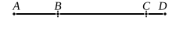

Let $AB$ be the straight line which produces with a rational 
area a medial whole, 
and let $BC$ be an annex to $AB$;

therefore $AC$, $CB$ are straight lines 
incommensurable in square which fulfil the given conditions. 
[X. 77]

I say that no other straight line can be annexed to $AB$ 
which fulfils the same conditions.

For, if possible, let $BD$ be so annexed;

therefore $AD$, $DB$ are also straight lines incommensurable in 
square which fulfil the given conditions. [X. 77]

Since then, as in the preceding cases, 
the excess of the squares on $AD$, $DB$ over the squares on 
$AC$, $CB$ is also the excess of twice the rectangle $AD$, $DB$ 
over twice the rectangle $AC$, $CB$, 
while twice the rectangle $AD$, $DB$ exceeds twice the rectangle 
$AC$, $CB$ by a rational area, 
for both are rational,

therefore the squares on $AD$, $DB$ also exceed the squares 
on $AC$, $CB$ by a rational area: 
which is impossible, for both are medial. [X. 26]

Therefore no other straight line can be annexed to $AB$ 
which is incommensurable in square with the whole and which 
with the whole fulfils the aforesaid conditions; 
therefore only one straight line can be so annexed.

Q. E. D.

---

Suppose, with the same notation, that
$$x - y = x' - y'. \qquad (x > x')$$

Here, $(x^2 + y^2)$, $(x'^2 + y'^2)$ being both medial areas, and $2xy$, $2x'y'$ both 
rational areas, 
while
$$(x^2 + y^2) - (x'^2 + y'^2) = 2xy - 2x'y',$$
X. 26 is contradicted again.

Therefore etc.

---

### Proposition 84.

To a straight line which produces with a medial area a 
medial whole only one straight line can be annexed which is 
incommensurable in square with the whole straight line and 
which with the whole straight line makes the sum of the squares

