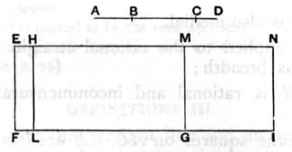

*on them medial and twice the rectangle contained by them both
medial and also incommensurable with the sum of the squares
on them.*

Let *AB* be the straight line which produces with a medial
area a medial whole,
and *BC* an annex to it;
therefore *AC*, *CB* are straight lines incommensurable in square
which fulfil the aforesaid conditions. \[[x. 78](x.78.md)\]

I say that no other straight line can be annexed to *AB*
which fulfils the aforesaid conditions.

For, if possible, let *BD* be so annexed,
so that *AD*, *DB* are also straight lines incommensurable in
square which make the squares on *AD*, *DB* added together
medial, twice the rectangle *AD*, *DB* medial, and also the
squares on *AD*, *DB* incommensurable with twice the rectangle
*AD*, *DB*. \[[x. 78](x.78.md)\]

Let a rational straight line *EF* be set out,
let *EG* equal to the squares on *AC*, *CB* be applied to *EF*,
producing *EM* as breadth,
and let *HG* equal to twice the rectangle *AC*, *CB* be applied
to *EF*, producing *HM* as breadth;
therefore the remainder, the square on *AB* \[[II. 7](II.7.md)\], is equal
to *EL*;
therefore *AB* is the "side" of *EL*.

Again, let *EI* equal to the squares on *AD*, *DB* be applied
to *EF*, producing *EN* as breadth.
But the square on *AB* is also equal to *EL*;
therefore the remainder, twice the rectangle *AD*, *DB* \[[II. 7](II.7.md)\],
is equal to *HI*.
