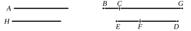

### PROPOSITION 85.

*To find the first apotome.*

Let a rational straight line $A$ be set out, and let $BG$ be commensurable in length with $A$;
therefore $BG$ is also rational.

Let two square numbers $DE$, $EF$ be set out, and let their difference $FD$ not be square;
therefore neither has $ED$ to $DF$ the ratio which a square number has to a square number.

Let it be contrived that,
as $ED$ is to $DF$, so is the square on $BG$ to the square on $GC$; \[[x. 6, Por.](x.6.md)\]
therefore the square on $BG$ is commensurable with the square on $GC$. \[[x. 6](x.6.md)\]

But the square on $BG$ is rational;
therefore the square on $GC$ is also rational;
therefore $GC$ is also rational.

And, since $ED$ has not to $DF$ the ratio which a square number has to a square number,
therefore neither has the square on $BG$ to the square on $GC$ the ratio which a square number has to a square number;
therefore $BG$ is incommensurable in length with $GC$. \[[x. 9](x.9.md)\]

And both are rational;
therefore $BG$, $GC$ are rational straight lines commensurable in square only;
therefore $BC$ is an apotome. \[[x. 73](x.73.md)\]

I say next that it is also a first apotome.

For let the square on $H$ be that by which the square on $BG$ is greater than the square on $GC$.

Now since, as $ED$ is to $FD$, so is the square on $BG$ to the square on $GC$,
therefore also, *convertendo*, \[[v. 19, Por.](v.19.md)\]
as $DE$ is to $EF$, so is the square on $GB$ to the square on $H$.
