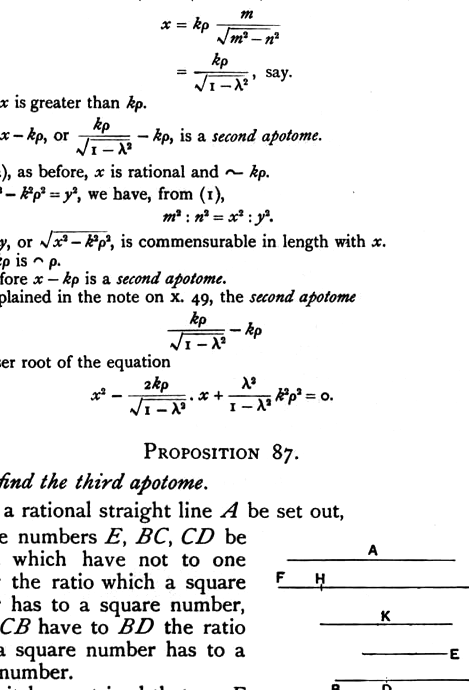

by the square on a straight line commensurable in length with $BG$.

And $CG$, the annex, is commensurable with the rational straight line $A$ set out.

Therefore $BC$ is a second apotome. \[[x. Deff. III. 2](deff.x.3.md)\]

Therefore the second apotome $BC$ has been found.

$$\text{Q. E. D.}$$

---

Take, as before, $k\rho$ commensurable in length with $\rho$.
Let $m^2, n^2$ be again square numbers, but $(m^2 - n^2)$ not square.
Take $x$ such that
$$(m^2 - n^2) : m^2 = k^2\rho^2 : x^2 \tag{1},$$
whence
$$x = k\rho \frac{m}{\sqrt{m^2 - n^2}}$$
$$= \frac{k\rho}{\sqrt{1 - \lambda^2}}, \text{ say.}$$

Thus $x$ is greater than $k\rho$.
Then $x - k\rho$, or $\frac{k\rho}{\sqrt{1 - \lambda^2}} - k\rho$, is a *second apotome*.

For ($\alpha$), as before, $x$ is rational and $\sim k\rho$.
($\beta$) If $x^2 - k^2\rho^2 = y^2$, we have, from (1),
$$m^2 : n^2 = x^2 : y^2.$$
Thus $y$, or $\sqrt{x^2 - k^2\rho^2}$, is commensurable in length with $x$.
And $k\rho \frown \rho$.
Therefore $x - k\rho$ is a *second apotome*.

As explained in the note on x. 49, the second apotome
$$\frac{k\rho}{\sqrt{1 - \lambda^2}} - k\rho$$
is the lesser root of the equation
$$x^2 - \frac{2k\rho}{\sqrt{1 - \lambda^2}} \cdot x + \frac{\lambda^2}{1 - \lambda^2} k^2\rho^2 = 0.$$

---

### PROPOSITION 87.

*To find the third apotome.*

Let a rational straight line $A$ be set out,
let three numbers $E, BC, CD$ be set out which have not to one another the ratio which a square number has to a square number,
but let $CB$ have to $BD$ the ratio which a square number has to a square number.

Let it be contrived that, as $E$ is to $BC$, so is the square on $A$ to the square on $FG$,
