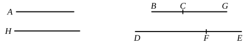

($\beta$) By (1), (2), *ex aequali*,
$$p : q(m^2 - n^2) = \rho^2 : y^2,$$
whence $y \smile \rho$.

Thus, by this and (3), $x, y$ are both $\smile \rho$ .................................................(4).

Lastly, let $z^2 = x^2 - y^2$, so that, from (2), *convertendo*,
$$qm^2 : qn^2 = x^2 : z^2;$$
therefore $z$, or $\sqrt{x^2 - y^2}, \frown x$ .................................................(5).

Thus [(4) and (5)] $(x - y)$ is a third apotome.

To find its form, we have, from (1) and (2),
$$x = \rho \cdot \frac{m\sqrt{q}}{\sqrt{p}},$$
$$y = \rho \cdot \frac{\sqrt{m^2 - n^2} \cdot \sqrt{q}}{\sqrt{p}},$$
so that
$$x - y = \sqrt{\frac{q}{p}} \cdot \rho (m - \sqrt{m^2 - n^2}).$$

This may be written in the form
$$m\sqrt{k} \cdot \rho - m\sqrt{k} \cdot \rho \sqrt{1 - \lambda^2}.$$

As explained in the note on x. 50, this is the lesser root of the equation
$$x^2 - 2m\sqrt{k} \cdot \rho x + \lambda^2 m^2 k\rho^2 = 0.$$

---

### PROPOSITION 88.

*To find the fourth apotome.*

Let a rational straight line $A$ be set out, and $BG$ commensurable in length with it;
therefore $BG$ is also rational.

Let two numbers $DF, FE$ be set out such that the whole $DE$ has not to either of the numbers $DF, EF$ the ratio which a square number has to a square number.

Let it be contrived that, as $DE$ is to $EF$, so is the square on $BG$ to the square on $GC$; \[[x. 6, Por.](x.6.md)\]
therefore the square on $BG$ is commensurable with the square on $GC$. \[[x. 6](x.6.md)\]

But the square on $BG$ is rational;
therefore the square on $GC$ is also rational;
therefore $GC$ is rational.
