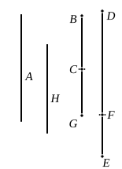

For, by (1), $x$ is rational and $\sim k\rho$.
Also $\sqrt{k^2\rho^2 - x^2}$ is incommensurable with $k\rho$, since
$$(m+n) : m = k^2\rho^2 : (k^2\rho^2 - x^2)\text{,}$$
and the ratio $(m+n) : m$ is not that of a square number to a square number.
And $k\rho \sim \rho$.
As explained in the note on x. 51, the *fourth apotome*
$$k\rho - \frac{k\rho}{\sqrt{1+\lambda}}$$
is the lesser root of the quadratic equation
$$x^2 - 2k\rho \cdot x + \frac{\lambda}{1+\lambda} k^2\rho^2 = 0.$$

---

### PROPOSITION 89.

*To find the fifth apotome.*

Let a rational straight line *A* be set out,
and let *CG* be commensurable in length
with *A*;
therefore *CG* is rational.
Let two numbers *DF*, *FE* be set out
such that *DE* again has not to either of the
numbers *DF*, *FE* the ratio which a square
number has to a square number;
and let it be contrived that, as *FE* is to *ED*,
so is the square on *CG* to the square on *GB*.
Therefore the square on *GB* is also
rational; [x. 6]
therefore *BG* is also rational.

Now since, as *DE* is to *EF*, so is the square on *BG* to
the square on *GC*,
while *DE* has not to *EF* the ratio which a square number
has to a square number,
therefore neither has the square on *BG* to the square on *GC*
the ratio which a square number has to a square number;
therefore *BG* is incommensurable in length with *GC*. [x. 9]
And both are rational;
therefore *BG*, *GC* are rational straight lines commensurable
in square only;
therefore *BC* is an apotome. [x. 73]
