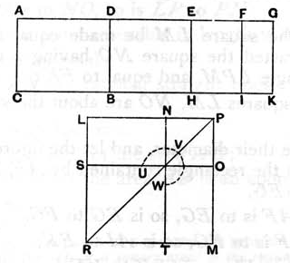

For, since *AD* is a first apotome, let *DG* be its annex ;
therefore *AG*, *GD* are rational straight lines commensurable
in square only. [x. 73]
And the whole *AG* is commensurable with the rational
straight line *AC* set out,
and the square on *AG* is greater than the square on *GD*
by the square on a straight line commensurable in length
with *AG*; [x. Deff. III. 1]
if therefore there be applied to *AG* a parallelogram equal to
the fourth part of the square on *DG* and deficient by a square
figure, it divides it into commensurable parts. [x. 17]

Let *DG* be bisected at *E*,
let there be applied to *AG* a parallelogram equal to the square
on *EG* and deficient by a square figure,
and let it be the rectangle *AF*, *FG*;
therefore *AF* is commensurable with *FG*.
And through the points *E*, *F*, *G* let *EH*, *FI*, *GK* be drawn
parallel to *AC*.

Now, since *AF* is commensurable in length with *FG*,
therefore *AG* is also commensurable in length with each of
the straight lines *AF*, *FG*. [x. 15]
But *AG* is commensurable with *AC*;
therefore each of the straight lines *AF*, *FG* is commensurable
in length with *AC*. [x. 12]
