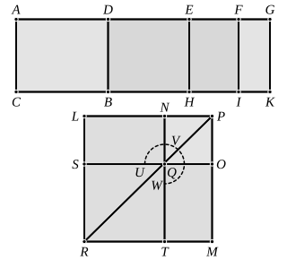

### PROPOSITION 94.

*If an area be contained by a rational straight line and a fourth apotome, the “side” of the area is minor.*

For let the area ">$AB$ be contained by the rational straight line $AC$ and the fourth apotome $AD$;
I say that the “side” of the area ">$AB$ is minor.

For let $DG$ be the annex to $AD$;
therefore $AG$, $GD$ are rational straight lines commensurable in square only,
$AG$ is commensurable in length with the rational straight line $AC$ set out,
and the square on the whole $AG$ is greater than the square on the annex $DG$ by the square on a straight line incommensurable in length with $AG$, [x. Deff. III. 4]

Since then the square on $AG$ is greater than the square on $GD$ by the square on a straight line incommensurable in length with $AG$,
therefore, if there be applied to $AG$ a parallelogram equal to the fourth part of the square on $GD$ and deficient by a square figure, it will divide it into incommensurable parts. [x. 18]
Let then $DG$ be bisected at $E$,
let there be applied to $AG$ a parallelogram equal to the square on $EG$ and deficient by a square figure,
and let it be the rectangle $AF$, $FG$;
therefore $AF$ is incommensurable in length with $FG$.
