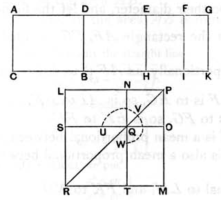

### PROPOSITION 94.

*If an area be contained by a rational straight line and a fourth apotome, the “side” of the area is minor.*

For let the area *AB* be contained by the rational straight line *AC* and the fourth apotome *AD*;
I say that the “side” of the area *AB* is minor.

For let *DG* be the annex to *AD*;
therefore *AG*, *GD* are rational straight lines commensurable in square only,
*AG* is commensurable in length with the rational straight line *AC* set out,
and the square on the whole *AG* is greater than the square on the annex *DG* by the square on a straight line incommensurable in length with *AG*, [x. Deff. III. 4]

Since then the square on *AG* is greater than the square on *GD* by the square on a straight line incommensurable in length with *AG*,
therefore, if there be applied to *AG* a parallelogram equal to the fourth part of the square on *GD* and deficient by a square figure, it will divide it into incommensurable parts. [x. 18]
Let then *DG* be bisected at *E*,
let there be applied to *AG* a parallelogram equal to the square on *EG* and deficient by a square figure,
and let it be the rectangle *AF*, *FG*;
therefore *AF* is incommensurable in length with *FG*.
