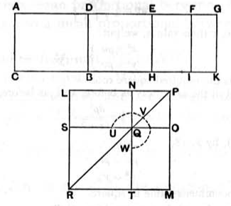

Algebraical solution gives
$$u = \frac{1}{2} k\rho \left(1 + \sqrt{\frac{\lambda}{1 + \lambda}}\right),$$
$$v = \frac{1}{2} k\rho \left(1 - \sqrt{\frac{\lambda}{1 + \lambda}}\right),$$
whence
$$x - y = \rho \sqrt{\frac{k}{2}\left(1 + \sqrt{\frac{\lambda}{1 + \lambda}}\right)} - \rho \sqrt{\frac{k}{2}\left(1 - \sqrt{\frac{\lambda}{1 + \lambda}}\right)}.$$

As explained in the note on **X. 57**, this is the lesser positive root of the equation
$$x^4 - 2k\rho^2 \cdot x^2 + \frac{\lambda}{1 + \lambda} k^2\rho^4 = 0.$$

---

### PROPOSITION 95.

*If an area be contained by a rational straight line and a fifth apotome, the "side" of the area is a straight line which produces with a rational area a medial whole.*

For let the area $AB$ be contained by the rational straight line $AC$ and the fifth apotome $AD$;
I say that the "side" of the area $AB$ is a straight line which produces with a rational area a medial whole.

For let $DG$ be the annex to $AD$;
therefore $AG$, $GD$ are rational straight lines commensurable in square only,

the annex $GD$ is commensurable in length with the rational straight line $AC$ set out,
and the square on the whole $AG$ is greater than the square
