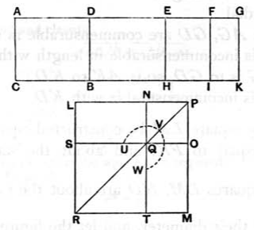

### PROPOSITION 96.

*If an area be contained by a rational straight line and a sixth apotome, the "side" of the area is a straight line which produces with a medial area a medial whole.*

For let the area $AB$ be contained by the rational straight line $AC$ and the sixth apotome $AD$;
I say that the "side" of the area $AB$ is a straight line which produces with a medial area a medial whole.

For let $DG$ be the annex to $AD$;
therefore $AG$, $GD$ are rational straight lines commensurable in square only,
neither of them is commensurable in length with the rational straight line $AC$ set out,
and the square on the whole $AG$ is greater than the square on the annex $DG$ by the square on a straight line incommensurable in length with $AG$. \hfill [x. Deff. III. 6]

Since then the square on $AG$ is greater than the square on $GD$ by the square on a straight line incommensurable in length with $AG$,
therefore, if there be applied to $AG$ a parallelogram equal to the fourth part of the square on $DG$ and deficient by a square figure, it will divide it into incommensurable parts. \hfill [x. 18]

Let then $DG$ be bisected at $E$,
let there be applied to $AG$ a parallelogram equal to the square
