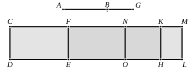

And, since $\rho^2 \sim k\rho^2$,
$$\begin{aligned}
\sigma x &\sim \sigma y, \\
\text{or } \quad x &\sim y \dots\dots\dots\dots\dots\dots\dots\dots\dots\dots\dots(6).
\end{aligned}$$

Hence [(5), (6)], by x. 17,
$$\sqrt{(x + y)^2 - (2z)^2} \sim (x + y).$$

And [(4)] $(x + y)$, $2z$ are rational and $\sim$, 
while [(2)] $(x + y) \sim \sigma$; 
therefore $(x + y) - 2z$ is a *first apotome*.

The actual value of $(x + y) - 2z$ is of course
$$\frac{\rho^2}{\sigma}\{(1 + k) - 2\sqrt{k}\}.$$

---

### PROPOSITION 98.

The square on a first apotome of a medial straight line 
applied to a rational straight line produces as breadth a second 
apotome.

Let $AB$ be a first apotome of a medial straight line and 
$CD$ a rational straight line, 
and to $CD$ let there be applied ">$CE$ equal to the square on 
$AB$, producing $CF$ as breadth; 
I say that $CF$ is a second apotome.

For let $BG$ be the annex to $AB$;

therefore $AG$, $GB$ are medial straight lines commensurable in 
square only which contain a rational rectangle. [x. 74]

To $CD$ let there be applied ">$CH$ equal to the square on 
$AG$, producing $CK$ as breadth, and ">$KL$ equal to the square 
on $GB$, producing $KM$ as breadth;

therefore the whole ">$CL$ is equal to the squares on $AG$, $GB$; 
therefore ">$CL$ is also medial. [x. 15 and 23, Por.]

And it is applied to the rational straight line $CD$, pro- 
ducing $CM$ as breadth;

therefore $CM$ is rational and incommensurable in length with 
$CD$. [x. 22]

