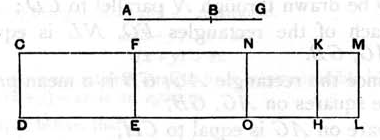

And, since $\rho^2 \sim k\rho^2$,
$$\begin{aligned}
\sigma x &\sim \sigma y, \\
\text{or } \quad x &\sim y \dots\dots\dots\dots\dots\dots\dots\dots\dots\dots\dots(6).
\end{aligned}$$

Hence [(5), (6)], by x. 17,
$$\sqrt{(x + y)^2 - (2z)^2} \sim (x + y).$$

And [(4)] $(x + y)$, $2z$ are rational and $\sim$,
while [(2)] $(x + y) \sim \sigma$;
therefore $(x + y) - 2z$ is a *first apotome*.

The actual value of $(x + y) - 2z$ is of course
$$\frac{\rho^2}{\sigma}\{(1 + k) - 2\sqrt{k}\}.$$

---

### PROPOSITION 98.

*The square on a first apotome of a medial straight line applied to a rational straight line produces as breadth a second apotome.*

Let *AB* be a first apotome of a medial straight line and *CD* a rational straight line,
and to *CD* let there be applied *CE* equal to the square on *AB*, producing *CF* as breadth;
I say that *CF* is a second apotome.

For let *BG* be the annex to *AB*;
therefore *AG*, *GB* are medial straight lines commensurable in square only which contain a rational rectangle. [x. 74]

To *CD* let there be applied *CH* equal to the square on *AG*, producing *CK* as breadth, and *KL* equal to the square on *GB*, producing *KM* as breadth;
therefore the whole *CL* is equal to the squares on *AG*, *GB*;
therefore *CL* is also medial. [x. 15 and 23, Por.]

And it is applied to the rational straight line *CD*, producing *CM* as breadth;
therefore *CM* is rational and incommensurable in length with *CD*. [x. 22]
