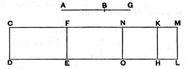

### PROPOSITION 99.

*The square on a second apotome of a medial straight line applied to a rational straight line produces as breadth a third apotome.*

Let *AB* be a second apotome of a medial straight line, and *CD* rational,
and to *CD* let there be applied *CE* equal to the square on *AB*, producing *CF* as breadth;
I say that *CF* is a third apotome.

For let *BG* be the annex to *AB*;
therefore *AG*, *GB* are medial straight lines commensurable in square only which contain a medial rectangle. [x. 75]

Let *CH* equal to the square on *AG* be applied to *CD*, producing *CK* as breadth,
and let *KL* equal to the square on *BG* be applied to *KH*, producing *KM* as breadth;
therefore the whole *CL* is equal to the squares on *AG*, *GB*;
therefore *CL* is also medial. [x. 15 and 23, Por.]

And it is applied to the rational straight line *CD*, producing *CM* as breadth;
therefore *CM* is rational and incommensurable in length with *CD*. [x. 22]

Now, since the whole *CL* is equal to the squares on *AG*, *GB*, and, in these, *CE* is equal to the square on *AB*,
therefore the remainder *LF* is equal to twice the rectangle *AG*, *GB*. [II. 7]

Let then *FM* be bisected at the point *N*,
and let *NO* be drawn parallel to *CD*;
therefore each of the rectangles *FO*, *NL* is equal to the rectangle *AG*, *GB*.
