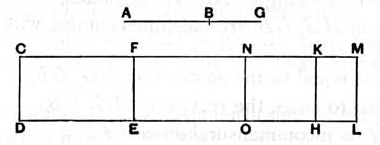

Thus [(1), (2), (3)] $(x + y)$, $2z$ are rational and $\sim$,
so that $(x + y) - 2z$ is an *apotome*.

$(\beta)$ $\sigma x \sim \sigma y$, so that $x \sim y$.

And, as before,
$$xy = \frac{1}{4}(2z)^2.$$

Therefore [x. 17]
$$\sqrt{(x + y)^2 - (2z)^2} \sim (x + y).$$

And neither $(x + y)$ nor $2z$ is $\sim \sigma$.

Therefore $(x + y) - 2z$ is a *third apotome*.

It is of course equal to
$$\frac{\rho^2}{\sigma}\left\{\frac{k + \lambda}{\sqrt{k}} - 2\sqrt{\lambda}\right\}.$$

---

### PROPOSITION 100.

*The square on a minor straight line applied to a rational straight line produces as breadth a fourth apotome.*

Let *AB* be a minor and *CD* a rational straight line, and to the rational straight line *CD* let *CE* be applied equal to the square on *AB* and producing *CF* as breadth;
I say that *CF* is a fourth apotome.

For let *BG* be the annex to *AB*;
therefore *AG*, *GB* are straight lines incommensurable in square which make the sum of the squares on *AG*, *GB* rational, but twice the rectangle *AG*, *GB* medial. [x. 76]

To *CD* let there be applied *CH* equal to the square on *AG* and producing *CK* as breadth,
and *KL* equal to the square on *BG*, producing *KM* as breadth;
therefore the whole *CL* is equal to the squares on *AG*, *GB*.

And the sum of the squares on *AG*, *GB* is rational;
therefore *CL* is also rational.

And it is applied to the rational straight line *CD*, producing *CM* as breadth;
therefore *CM* is also rational and commensurable in length with *CD*. [x. 20]
