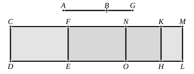

It follows that $\sigma(x+y)$ is rational and $\sigma \cdot 2z$ medial,
so that $(x+y)$ is rational and $\sim \sigma$ ....................................(1),
while $2z$ is rational and $\smile \sigma$ ........................................(2),
and $\sigma(x+y) \smile \sigma \cdot 2z$,
so that $(x+y) \smile 2z$ ................................................(3).

Thus [(1), (2), (3)] $(x+y)$, $2z$ are rational and $\sim$,
so that $(x+y) - 2z$ is an apotome.

Next, since
$$u^2 \smile v^2,$$
$$\sigma x \smile \sigma y,$$
or
$$x \smile y.$$

And it is proved, as usual, that
$$xy = z^2 = \frac{1}{4}(2z)^2.$$

Therefore [X. 18] $\sqrt{(x+y)^2 - (2z)^2} \smile (x+y)$.

But $(x+y) \sim \sigma$,
therefore $x+y-2z$ is a _fourth apotome_.

Its value is of course $\frac{\rho^2}{\sigma}\left(1 - \frac{1}{\sqrt{1+k^2}}\right)$.

---

### PROPOSITION 101.

_The square on the straight line which produces with a rational area a medial whole, if applied to a rational straight line, produces as breadth a fifth apotome._

Let _AB_ be the straight line which produces with a rational area a medial whole, and _CD_ a rational straight line, and to _CD_ let _CE_ be applied equal to the square on _AB_ and producing _CF_ as breadth;
I say that _CF_ is a fifth apotome.

For let _BG_ be the annex to _AB_; therefore _AG_, _GB_ are straight lines incommensurable in square which make the sum of the squares on them medial but twice the rectangle contained by them rational. [X. 77]

To _CD_ let there be applied _CH_ equal to the square on _AG_, and _KL_ equal to the square on _GB_; therefore the whole _CL_ is equal to the squares on _AG_, _GB_.
