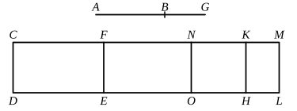

### PROPOSITION 102.

The square on the straight line which produces with a 
medial area a medial whole, if applied to a rational straight 
line, produces as breadth a sixth apotome.

Let $AB$ be the straight line which produces with a medial 
area a medial whole, and $CD$ a rational straight line, 
and to $CD$ let ">$CE$ be applied equal to the square on $AB$ and 
producing $CF$ as breadth; 
I say that $CF$ is a sixth apotome.

For let $BG$ be the annex to $AB$;

therefore $AG$, $GB$ are straight lines incommensurable in 
square which make the sum of the squares on them medial, 
twice the rectangle $AG$, $GB$ medial, and the squares on $AG$, 
$GB$ incommensurable with twice the rectangle $AG$, $GB$. [X. 78]

Now to $CD$ let there be applied ">$CH$ equal to the square 
on $AG$ and producing $CK$ as breadth, 
and ">$KL$ equal to the square on $BG$;

therefore the whole ">$CL$ is equal to the squares on $AG$, $GB$; 
therefore ">$CL$ is also medial.

And it is applied to the rational straight line $CD$, produc- 
ing $CM$ as breadth;

therefore $CM$ is rational and incommensurable in length 
with $CD$. [X. 22]

Since now ">$CL$ is equal to the squares on $AG$, $GB$, 
and, in these, ">$CE$ is equal to the square on $AB$,

therefore the remainder ">$FL$ is equal to twice the rectangle 
$AG$, $GB$. [II. 7]

And twice the rectangle $AG$, $GB$ is medial;

therefore ">$FL$ is also medial.

