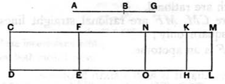

### PROPOSITION 102.

_The square on the straight line which produces with a medial area a medial whole, if applied to a rational straight line, produces as breadth a sixth apotome._

Let _AB_ be the straight line which produces with a medial area a medial whole, and _CD_ a rational straight line, and to _CD_ let _CE_ be applied equal to the square on _AB_ and producing _CF_ as breadth;
I say that _CF_ is a sixth apotome.

For let _BG_ be the annex to _AB_; therefore _AG_, _GB_ are straight lines incommensurable in square which make the sum of the squares on them medial, twice the rectangle _AG_, _GB_ medial, and the squares on _AG_, _GB_ incommensurable with twice the rectangle _AG_, _GB_. [X. 78]

Now to _CD_ let there be applied _CH_ equal to the square on _AG_ and producing _CK_ as breadth, and _KL_ equal to the square on _BG_; therefore the whole _CL_ is equal to the squares on _AG_, _GB_; therefore _CL_ is also medial.

And it is applied to the rational straight line _CD_, producing _CM_ as breadth; therefore _CM_ is rational and incommensurable in length with _CD_. [X. 22]

Since now _CL_ is equal to the squares on _AG_, _GB_, and, in these, _CE_ is equal to the square on _AB_, therefore the remainder _FL_ is equal to twice the rectangle _AG_, _GB_. [II. 7]

And twice the rectangle _AG_, _GB_ is medial; therefore _FL_ is also medial.
