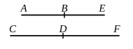

And for the same reason as before the square on $CM$ is greater than the square on $MF$ by the square on a straight line incommensurable with $CM$. [X. 18]

And neither of them is commensurable with the rational straight line $CD$ set out; therefore $CF$ is a sixth apotome. [X. Deff. III. 6]

Q. E. D.

---

We have to find and classify
$$\frac{1}{\sigma}\left\{\frac{\rho\lambda^{\frac{1}{4}}}{\sqrt{2}}\sqrt{1+\frac{k}{\sqrt{1+k^2}}} - \frac{\rho\lambda^{\frac{1}{4}}}{\sqrt{2}}\sqrt{1-\frac{k}{\sqrt{1+k^2}}}\right\}^2.$$

Call this $\frac{1}{\sigma}(u-v)^2$, and put
$$\left.\begin{aligned}
\sigma x &= u^2, \\
\sigma y &= v^2, \\
\sigma \cdot 2z &= 2uv.
\end{aligned}\right.$$

Here $u^2, v^2$ are incommensurable, $(u^2+v^2), 2uv$ are both medial areas, and
$$(u^2+v^2) \smile 2uv.$$

Since $\sigma(x+y), \sigma \cdot 2z$ are medial and incommensurable,
$(x+y)$ is rational and $\smile \sigma$,
$2z$ is rational and $\smile \sigma$,
and
$$(x+y) \smile 2z.$$

Hence $(x+y), 2z$ are rational and $\sim$,
so that $(x+y) - 2z$ is an apotome.

Again, since $u^2, v^2$, or $\sigma x, \sigma y$, are incommensurable,
$$x \smile y.$$

And, as before,
$$xy = z^2 = \frac{1}{4}(2z)^2.$$

Therefore [X. 18]
$$\sqrt{(x+y)^2 - (2z)^2} \smile (x+y).$$

And neither $(x+y)$ nor $2z$ is $\frown \sigma$;
therefore $(x+y) - 2z$ is a _sixth apotome_.

It is of course
$$\frac{\rho^2}{\sigma}\left(\sqrt{\lambda} - \frac{\sqrt{\lambda}}{\sqrt{1+k^2}}\right).$$

---

### PROPOSITION 103.

_A straight line commensurable in length with an apotome is an apotome and the same in order._

Let $AB$ be an apotome, and let $CD$ be commensurable in length with $AB$;
I say that $CD$ is also an apotome and the same in order with $AB$.

