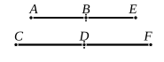

I say next that it is also the same in order with $AB$.

Since, as $AE$ is to $EB$, so is $CF$ to $FD$,

therefore also, as the square on $AE$ is to the rectangle $AE$, 
$EB$, so is the square on $CF$ to the rectangle $CF$, $FD$.

But the square on $AE$ is commensurable with the square 
on $CF$;

therefore the rectangle $AE$, $EB$ is also commensurable with 
the rectangle $CF$, $FD$. [V. 16, X. 11]

Therefore, if the rectangle $AE$, $EB$ is rational, the rect- 
angle $CF$, $FD$ will also be rational, [X. Def. 4] 
and if the rectangle $AE$, $EB$ is medial, the rectangle $CF$, $FD$ 
is also medial. [X. 23, Por.]

Therefore $CD$ is an apotome of a medial straight line and 
the same in order with $AB$. [X. 74, 75]

Q. E. D.

---

### PROPOSITION 105.

A straight line commensurable with a minor straight line 
is minor.

Let $AB$ be a minor straight line, and $CD$ commensurable 
with $AB$;

I say that $CD$ is also minor.

Let the same construction be made 
as before;

then, since $AE$, $EB$ are incommensur- 
able in square, [X. 76]

therefore $CF$, $FD$ are also incommensurable in square. [X. 13]

Now since, as $AE$ is to $EB$, so is $CF$ to $FD$, [V. 12, V. 16]

therefore also, as the square on $AE$ is to the square on $EB$, 
so is the square on $CF$ to the square on $FD$. [VI. 22]

Therefore, *componendo*, as the squares on $AE$, $EB$ are to 
the square on $EB$, so are the squares on $CF$, $FD$ to the 
square on $FD$. [V. 18]

But the square on $BE$ is commensurable with the square 
on $DF$;

therefore the sum of the squares on $AE$, $EB$ is also commen- 
surable with the sum of the squares on $CF$, $FD$. [V. 16, X. 11]

But the sum of the squares on $AE$, $EB$ is rational; [X. 76]

therefore the sum of the squares on $CF$, $FD$ is also rational. 
[X. Def. 4]

