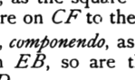

I say next that it is also the same in order with *AB*.

Since, as *AE* is to *EB*, so is *CF* to *FD*,
therefore also, as the square on *AE* is to the rectangle *AE*,
*EB*, so is the square on *CF* to the rectangle *CF*, *FD*.

But the square on *AE* is commensurable with the square
on *CF*;
therefore the rectangle *AE*, *EB* is also commensurable with
the rectangle *CF*, *FD*. [v. 16, x. 11]

Therefore, if the rectangle *AE*, *EB* is rational, the rect-
angle *CF*, *FD* will also be rational, [x. Def. 4]
and if the rectangle *AE*, *EB* is medial, the rectangle *CF*, *FD*
is also medial. [x. 23, Por.]

Therefore *CD* is an apotome of a medial straight line and
the same in order with *AB*. [x. 74, 75]

Q. E. D.

---

### PROPOSITION 105.

*A straight line commensurable with a minor straight line
is minor.*

Let *AB* be a minor straight line, and *CD* commensurable
with *AB*;
I say that *CD* is also minor.

Let the same construction be made
as before;
then, since *AE*, *EB* are incommensur-
able in square, [x. 76]
therefore *CF*, *FD* are also incommensurable in square. [x. 13]

Now since, as *AE* is to *EB*, so is *CF* to *FD*, [v. 12, v. 16]
therefore also, as the square on *AE* is to the square on *EB*,
so is the square on *CF* to the square on *FD*. [VI. 22]

Therefore, *componendo*, as the squares on *AE*, *EB* are to
the square on *EB*, so are the squares on *CF*, *FD* to the
square on *FD*. [v. 18]

But the square on *BE* is commensurable with the square
on *DF*;
therefore the sum of the squares on *AE*, *EB* is also commen-
surable with the sum of the squares on *CF*, *FD*. [v. 16, x. 11]

But the sum of the squares on *AE*, *EB* is rational; [x. 76]
therefore the sum of the squares on *CF*, *FD* is also rational.
[x. Def. 4]
