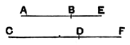

Again, since, as the square on *AE* is to the rectangle *AE*,
*EB*, so is the square on *CF* to the rectangle *CF*, *FD*,
while the square on *AE* is commensurable with the square
on *CF*,
therefore the rectangle *AE*, *EB* is also commensurable with
the rectangle *CF*, *FD*.

But the rectangle *AE*, *EB* is medial; [x. 76]
therefore the rectangle *CF*, *FD* is also medial; [x. 23, Por.]
therefore *CF*, *FD* are straight lines incommensurable in square
which make the sum of the squares on them rational, but the
rectangle contained by them medial.

Therefore *CD* is minor. [x. 76]

Q. E. D.

---

### PROPOSITION 106.

*A straight line commensurable with that which produces
with a rational area a medial whole is a straight line which
produces with a rational area a medial whole.*

Let *AB* be a straight line which produces with a rational
area a medial whole,
and *CD* commensurable with *AB*;
I say that *CD* is also a straight line
which produces with a rational area a
medial whole.

For let *BE* be the annex to *AB*;
therefore *AE*, *EB* are straight lines incommensurable in
square which make the sum of the squares on *AE*, *EB*
medial, but the rectangle contained by them rational. [x. 77]

Let the same construction be made.

Then we can prove, in manner similar to the foregoing,
that *CF*, *FD* are in the same ratio as *AE*, *EB*,
the sum of the squares on *AE*, *EB* is commensurable with
the sum of the squares on *CF*, *FD*,
and the rectangle *AE*, *EB* with the rectangle *CF*, *FD*;
so that *CF*, *FD* are also straight lines incommensurable in
square which make the sum of the squares on *CF*, *FD* medial,
but the rectangle contained by them rational.
