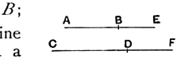

Therefore *CD* is a straight line which produces with a
rational area a medial whole. [x. 77]

Q. E. D.

---

### PROPOSITION 107.

*A straight line commensurable with that which produces
with a medial area a medial whole is itself also a straight line
which produces with a medial area a medial whole.*

Let *AB* be a straight line which produces with a medial
area a medial whole,
and let *CD* be commensurable with *AB*;
I say that *CD* is also a straight line
which produces with a medial area a
medial whole.

For let *BE* be the annex to *AB*,
and let the same construction be made;
therefore *AE*, *EB* are straight lines incommensurable in
square which make the sum of the squares on them medial,
the rectangle contained by them medial, and further the sum
of the squares on them incommensurable with the rectangle
contained by them. [x. 78]

Now, as was proved, *AE*, *EB* are commensurable with
*CF*, *FD*,
the sum of the squares on *AE*, *EB* with the sum of the
squares on *CF*, *FD*,
and the rectangle *AE*, *EB* with the rectangle *CF*, *FD*;
therefore *CF*, *FD* are also straight lines incommensurable in
square which make the sum of the squares on them medial,
the rectangle contained by them medial, and further the sum
of the squares on them incommensurable with the rectangle
contained by them.

Therefore *CD* is a straight line which produces with a
medial area a medial whole. [x. 78]
