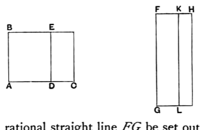

I say that the "side" of the remainder *EC* becomes one of two irrational straight lines, either a first apotome of a medial straight line or a straight line which produces with a rational area a medial whole.

For let a rational straight line *FG* be set out, and let the areas be similarly applied.

It follows then that *FH* is rational and incommensurable in length with *FG*,
while *KF* is rational and commensurable in length with *FG*;
therefore *FH*, *FK* are rational straight lines commensurable in square only; [x. 13]
therefore *KH* is an apotome, and *FK* the annex to it. [x. 73]

Now the square on *HF* is greater than the square on *FK* either by the square on a straight line commensurable with *HF* or by the square on a straight line incommensurable with it.

If then the square on *HF* is greater than the square on *FK* by the square on a straight line commensurable with *HF*, while the annex *FK* is commensurable in length with the rational straight line *FG* set out,
*KH* is a second apotome. [x. Deff. III. 2]

But *FG* is rational;
so that the "side" of *LH*, that is, of *EC*, is a first apotome of a medial straight line. [x. 92]

But, if the square on *HF* is greater than the square on *FK* by the square on a straight line incommensurable with *HF*, while the annex *FK* is commensurable in length with the rational straight line *FG* set out,
*KH* is a fifth apotome; [x. Deff. III. 5]
so that the "side" of *EC* is a straight line which produces with a rational area a medial whole. [x. 95]
